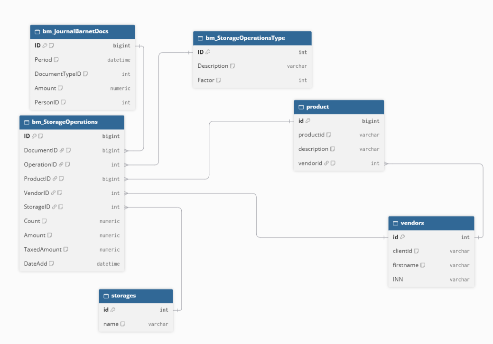
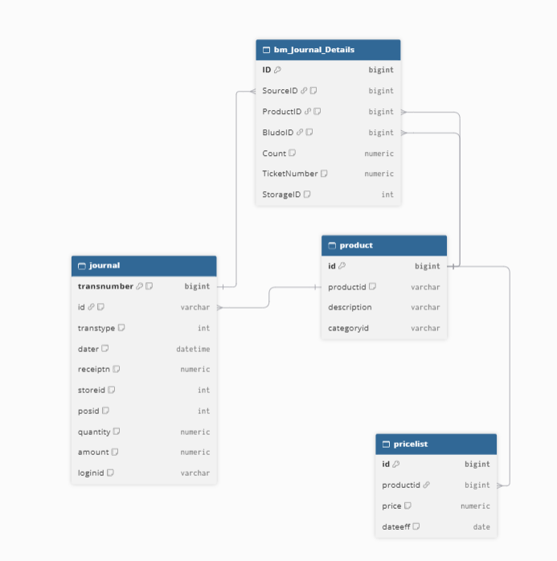
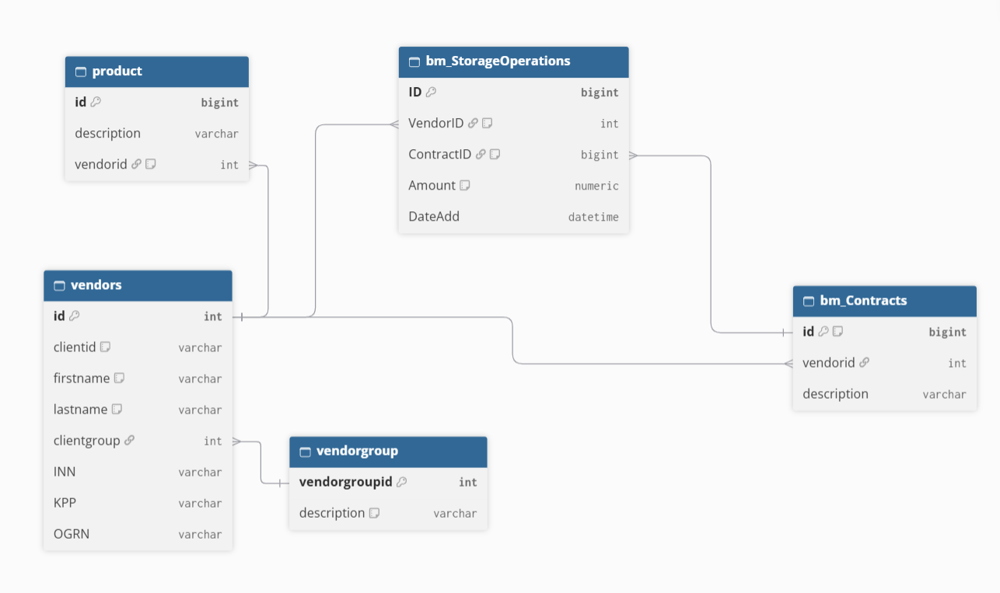
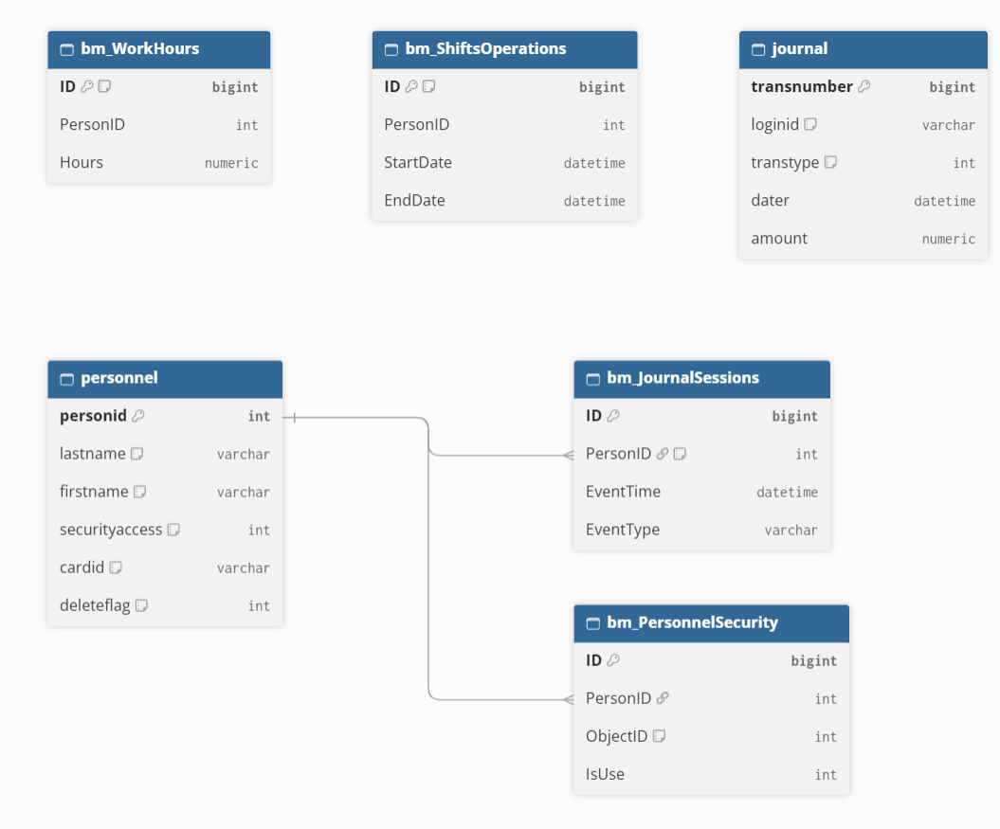
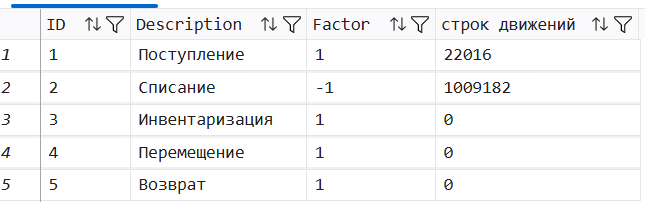
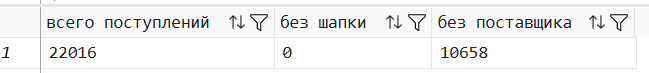
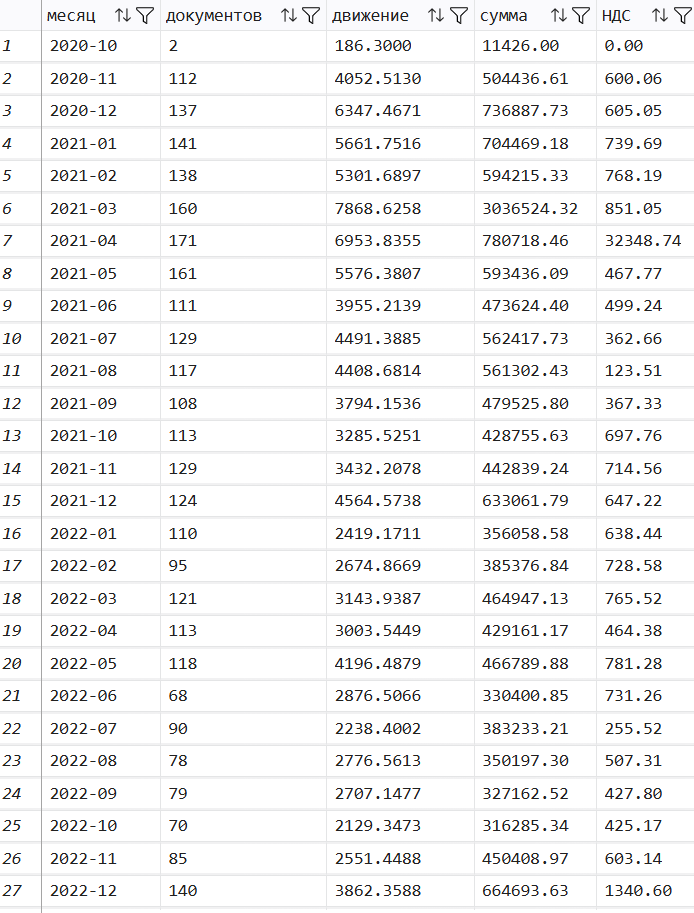
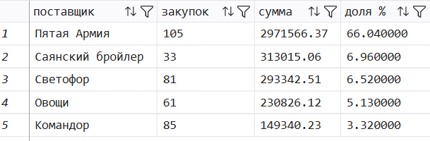
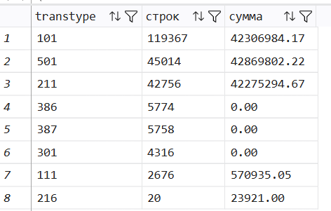

# Миграция базы данных Front: Анализ структуры и первичная миграция

## 1. Анализ наличия ресурсов

### Закупки продукции
**Основные таблицы:** `bm_StorageOperations` (движения товаров), `bm_JournalBarnetDocs` (шапки документов), `bm_StorageOperationsType` (справочник типов операций).  
**Связанные таблицы:** `product` (номенклатура), `vendors` (поставщики), `storages` (склады).

### Продажа товара
**Основные таблицы:** `journal` (кассовая лента), `bm_Journal_Details` (детализация чеков).  
**Связанные таблицы:** `product` (номенклатура), `pricelist` (прайс-лист), `recipe` (рецепты/состав блюд).

### Взаимоотношения с поставщиками
**Основные таблицы:** `vendors` (поставщики), `bm_StorageOperations` (движения закупок).  
**Связанные таблицы:** `bm_Contracts` (договоры - таблица пустая), `product` (номенклатура).

### Работа персонала
**Основные таблицы:** `personnel` (справочник сотрудников), `journal` (кассовая лента).  
**Связанные таблицы:** `bm_JournalSessions` (лог сессий), `bm_PersonnelSecurity` (права доступа).  
**Пустые таблицы:** `bm_ShiftsOperations` (1 строка), `bm_CashOperations` (0 строк), `bm_WorkHours` (0 строк).

### Остатки
**Источник данных:** `bm_StorageOperations` (история движений).  
**Связанные таблицы:** `product` (номенклатура), `storages` (склады), `bm_JournalBarnetDocs` (шапки документов).  
**Пустые таблицы:** `onhand` (0 строк), `storagesonhand` (0 строк).  
**Таблицы с данными:** `lngstock` (1797 строк), `lngstockr` (2121 строка) - справочники локализации.

---

## 2. Описание структуры базы данных

База данных `Front` развивалась более 15 лет, документация не сохранилась. Структуру восстанавливали эмпирически: анализировали состав таблиц, связи между ними и реальные выборки данных. Ниже приведено описание по пяти направлениям анализа.

### 2.1 Закупки продукции (шаг - месяц)

Закупки представляют собой складские движения с типом операции "Поступление" (OperationID = 1).

**Таблица `bm_StorageOperations` - движения товаров**

Всего 1 031 198 строк, из них 22 016 приходов (OperationID = 1) и 1 009 182 списаний (OperationID = 2). Каждая строка - одно движение товара по складу. Количество и сумма хранятся со знаком: приход положительный, расход отрицательный.

| Колонка | Назначение | Пример данных |
|---------|------------|---------------|
| ID | Уникальный идентификатор движения | 6326184 |
| DocumentID | Ссылка на шапку документа | 465989 |
| OperationID | Тип операции (1 = приход, 2 = расход) | 1 |
| ProductID | Ссылка на товар (product.id) | 4348 |
| VendorID | Ссылка на поставщика (vendors.id) | 0 |
| StorageID | Ссылка на склад | 41 |
| Count | Количество со знаком | 0.0000 |
| Quantity | Количество в дополнительных единицах | 0.0000 |
| Amount | Сумма операции со знаком | -7.22 |
| Taxed | Ставка НДС | 0.00 |
| TaxedAmount | Сумма НДС | 0.00 |
| Price | Цена за единицу | 240.79 |
| PriceCost | Себестоимость | 0.00 |
| Rest | Остаток после операции | 0.00 |
| Period | Период (строка формата ГГГГММДД) | '20231204' |
| DateAdd | Дата и время создания записи | 2023-12-04 21:55:37.210 |

**Важный нюанс:** `DateAdd` - это момент записи в базу, а не дата документа. Для помесячного анализа необходимо использовать дату из шапки документа (`bm_JournalBarnetDocs.Period`), а не `DateAdd`.

**Таблица `bm_JournalBarnetDocs` - шапки документов**

| Колонка | Назначение | Пример данных |
|---------|------------|---------------|
| ID | Уникальный идентификатор документа | 465989 |
| Period | Дата документа | 2023-12-04 20:13:13 |
| DocumentTypeID | Тип документа | 4 |
| JournalID | Журнал учёта | 3 |
| Amount | Сумма документа | 688.50 |
| PersonID | Сотрудник | 906 |
| ShiftID | Смена | 65 |
| TicketNumber | Номер чека | 59377270 |
| Comments | Комментарий | 'Сформировано автоматически' |

**Таблица `bm_StorageOperationsType` - типы операций**

Справочник содержит 5 типов операций:
- ID = 1: Поступление (Factor = +1)
- ID = 2: Списание (Factor = -1)
- ID = 3: Инвентаризация (Factor = +1)
- ID = 4: Перемещение (Factor = +1)
- ID = 5: Возврат (Factor = +1)

В реальных данных используются только первые два типа. Инвентаризаций, перемещений и возвратов в базе нет - это критично для анализа остатков.

**Связи:**
- `bm_StorageOperations.DocumentID` -> `bm_JournalBarnetDocs.ID` (связь проверена: 0 движений без шапки)
- `bm_StorageOperations.OperationID` -> `bm_StorageOperationsType.ID`
- `bm_StorageOperations.ProductID` -> `product.id`
- `bm_StorageOperations.VendorID` -> `vendors.id`
- `bm_StorageOperations.StorageID` -> `storages.id`

---

### 2.2 Продажа товара (шаг - месяц)

**Таблица `journal` - кассовая лента**

Всего 225 681 строка. Это не журнал документов (шапки чеков), а лента отдельных событий кассы: каждая строка - продажа товара, оплата или служебное действие. Чек собирается из нескольких строк по номеру `receiptn`.

| Колонка | Назначение | Пример данных |
|---------|------------|---------------|
| transnumber | Идентификатор строки | 1951181 |
| transtype | Тип события | 101 |
| dater | Дата события | 2023-12-06 13:58:26 |
| receiptn | Номер чека | 50672281 |
| storeid / posid | Точка продаж и касса | 0 / 5 |
| id | Артикул товара (строкой) | '7239833' |
| description | Название товара | 'Соус Барбекю' |
| quantity | Количество | 1.000 |
| price / amount | Цена и сумма | 50.00 / 50.00 |
| cost / basecost | Себестоимость | 0.00 |
| discount / discountamount | Скидка (процент и сумма) | 0 / 0.00 |
| tax1amount | Сумма налога | 0.00 |
| flagrefund | Признак возврата | 0 |
| loginid / loginbar | Сотрудник (строкой) | '906' |
| categoryid | Категория товара | '178' |

**Типы событий (transtype):**
- 101: Продажа (PLU Sales) - 119 367 строк
- 102: Возврат - 0 строк (в данных отсутствуют)
- 211, 216: Оплаты (наличные, карты) - 42 776 строк
- 301: Вход сотрудника - 4 316 строк
- 386, 387: Начало/конец смены - 11 532 строки
- 501: Итог чека - 45 014 строк

Для анализа продаж используется только `transtype = 101`.

**Таблица `bm_Journal_Details` - детализация чека (рецепт)**

10 896 410 строк. Содержит списание ингредиентов под проданное блюдо.

| Колонка | Назначение | Пример данных |
|---------|------------|---------------|
| ID | Идентификатор строки | 225297748 |
| SourceID | Ссылка на строку продажи (journal.transnumber) | 1950990 |
| ProductID | Ингредиент (product.id) | 7650 |
| BludoID | Блюдо | 4822 |
| sBrutto | Вес брутто (строкой) | '80.000' |
| Count | Расход ингредиента | 0.0800 |
| TicketNumber | Номер чека | 52169561 |
| StorageID | Склад | 41 |

**Связи:**
- `journal.id` = `product.productid` (строковый артикул, не числовой id!)
- `bm_Journal_Details.SourceID` -> `journal.transnumber`
- `bm_Journal_Details.ProductID` -> `product.id`
- `bm_Journal_Details.BludoID` -> `product.id`

---

### 2.3 Взаимоотношения с поставщиками (шаг - месяц)

**Таблица `vendors` - поставщики**

63 записи. Карточка поставщика переиспользует клиентскую структуру (поля `clientid`, `clientgroup`).

| Колонка | Назначение | Пример данных |
|---------|------------|---------------|
| id | Уникальный идентификатор | 91 |
| clientid | Краткое наименование | 'Габур' |
| firstname | Полное наименование | 'ИП Габур' |
| lastname | Фамилия (всегда NULL) | NULL |
| clientgroup | Группа (31 = Поставщики, 32 = Без названия) | 31 |
| INN | ИНН | '3840001848' |
| KPP | КПП | NULL |
| OGRN | ОГРН | NULL |
| datec | Дата создания | 2013-07-19 19:59:48.130 |

**Важно:** Поле `lastname` пустое у всех поставщиков. Реальное наименование хранится в `clientid` (краткое) и `firstname` (полное).

**Таблица `bm_Contracts` - договоры**

Таблица пустая (0 строк). Поле `ContractID` в `bm_StorageOperations` всегда равно 0 или NULL. Связь с договорами существует только структурно, данные не ведутся.

**Связи:**
- `bm_StorageOperations.VendorID` -> `vendors.id` (связь проверена данными)
- `bm_StorageOperations.ContractID` -> `bm_Contracts.id` (связь не работает, таблица пуста)
- `product.vendorid` -> `vendors.id` (поставщик по умолчанию)

---

### 2.4 Анализ работы персонала (шаг - квартал, полугодие)

**Таблица `personnel` - сотрудники**

109 записей. Содержит как реальных сотрудников, так и технические записи.

| Колонка | Назначение | Пример данных |
|---------|------------|---------------|
| personid | Уникальный идентификатор | 898 |
| lastname | Фамилия | 'Безик' |
| firstname | Имя | 'Татьяна' |
| middlename | Отчество | 'Сергеевна' |
| securityaccess | Роль / уровень доступа | 9 |
| cardid | Карта сотрудника | '110277' |
| percent | Процент (чаевые?) | 10.000 |
| deleteflag | Пометка удаления | 0 / 1 |

**Технические записи:** В справочнике есть записи "Кафе 1 Касса 1", "Кафе 2 Касса 2", "Доставка" (id 904-906) - это не люди, их нужно отделять от реальных сотрудников.

**Данные активности:**

Персонального разреза по людям в этом бэкапе **нет**. Все 119 367 продаж идут под одной технической записью `loginid = '906'` ("Доставка Доставка"). 

**Таблицы активности персонала:**
- `bm_ShiftsOperations`: 1 строка (PersonalID = 0, системная запись)
- `bm_CashOperations`: 0 строк
- `bm_WorkHours`: 0 строк
- `bm_JournalSessions`: служебный лог (897 - администратор, 156 923 события; 0 - система, 17 143 события)

**Вывод:** Анализ работы персонала возможен только в агрегированном виде по периодам (квартал, полугодие). Персональная статистика по сотрудникам недоступна.

---

### 2.5 Анализ остатков (шаг - неделя)

**Таблицы текущих остатков:**
- `onhand`: 0 строк
- `storagesonhand`: 0 строк

Готовых срезов остатков нет. Остаток приходится вычислять из истории движений: по каждому товару накапливаем `Count` за всю историю (с 2013 года) до конца нужной недели.

**Метод проверен:**
- По товарам с закупками остатки положительные и осмысленные: Нори водоросли = +4908.5250, Сок 0,2 = +1980.0000, Кока Кола 1,0 = +799.0000
- По ингредиентам (например, товар 4348) остаток уходит в минус (-1444.0040 к концу 2023 года). Причина: ингредиент расходуется под блюда (через `bm_Journal_Details`), но не приходуется, потому что операций производства в базе нет (только поступления и списания).

**Связи:**
- `bm_StorageOperations.ProductID` -> `product.id`
- `bm_StorageOperations.StorageID` -> `storages.id`
- `bm_StorageOperations.DocumentID` -> `bm_JournalBarnetDocs.ID`

---

## 3. ER-диаграммы

### 3.1 Закупки

Факт: `bm_StorageOperations`. Шапка: `bm_JournalBarnetDocs`. Связь `DocumentID` проверена данными (0 строк без шапки). Закупка = `OperationID = 1`, тип документа = 4.

### 3.2 Продажи

Кассовая лента: `journal`. Детализация: `bm_Journal_Details`. Связь с товаром по двум ключам: строковый артикул в `journal.id` и числовой `product.id` в рецепте.

### 3.3 Поставщики

Мост: `bm_StorageOperations.VendorID` -> `vendors.id`. Связь проверена данными. `ContractID` - связь структурная, в данных везде 0.

### 3.4 Персонал

Структура справочника: `personnel`. Связи: `journal.loginid` -> `personnel.personid`, `bm_JournalSessions.PersonID` -> `personnel.personid`. Таблицы активности пусты, все продажи под технической записью 906.

### 3.5 Остатки
`onhand` и `storagesonhand` пусты. Остаток на неделю вычисляется накопительно из движений `bm_StorageOperations`.

---

## 4. Проверочные запросы

Каждое направление подтверждается запросами к базе `Front`. Запросы проверяют три вещи:
1. Связи между таблицами настоящие (не битые)
2. Ключевые поля ведут себя как ожидается
3. Данные пригодны для анализа с заданным шагом

Результаты приложены скриншотами в порядке нумерации.

### 4.1 Анализ закупки продукции (шаг - месяц)

**Запрос 1.1. Сверка движений со справочником типов операций.**

RIGHT JOIN показывает все типы операций, включая те, по которым нет движений.

**Факт:** Тип 1 (Поступление) - 22 016 строк, тип 2 (Списание) - 1 009 182 строки. Типы 3, 4, 5 (Инвентаризация, Перемещение, Возврат) - 0 строк.

**Запрос 1.2. Целостность связи движение - шапка документа.**

Проверка: ни одно движение не висит без шапки, дату для помесячного анализа берём из шапки.

**Факт:** Всего 22 016 поступлений, без шапки - 0 строк. Без поставщика - 10 658 строк (48% закупок не имеют привязки к поставщику).

**Запрос 1.3. Закупки по месяцам за весь период.**

Шаг "месяц" работает, количество, сумма и НДС извлекаются через дату шапки.

**Факт:** 39 строк с октября 2020 по декабрь 2023. Январь 2021 - 141 документ на 704 469.18 с НДС 739.69. Декабрь 2023 неполный - 3 документа на 972.63 (данные заканчиваются 04.12.2023).

**Запрос 1.4. Топ-5 поставщиков 2023 года с долей в общем объёме.**

**Факт:** Пятая Армия лидирует с долей 66.04% (105 закупок на 2 971 566.37). Далее: Саянский бройлер (6.96%), Светофор (6.52%), Овощи (5.13%), Командор (3.32%).

---

### 4.2 Анализ продажи товара (шаг - месяц)

**Запрос 2.1. Полный спектр типов транзакций в кассовой ленте.**

**Факт:** 101 (продажи) - 119 367 строк на 42 306 984.17. 501 (итоги чеков) - 45 014 строк. 211 (оплаты) - 42 756 строк. 386/387 (смены) - 11 532 строки. 301 (входы) - 4 316 строк. Возвратов (102) - 0 строк.

